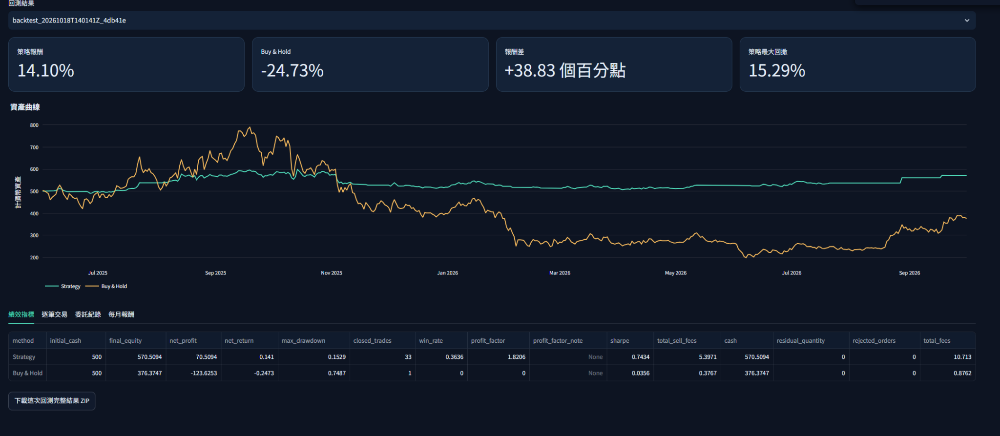
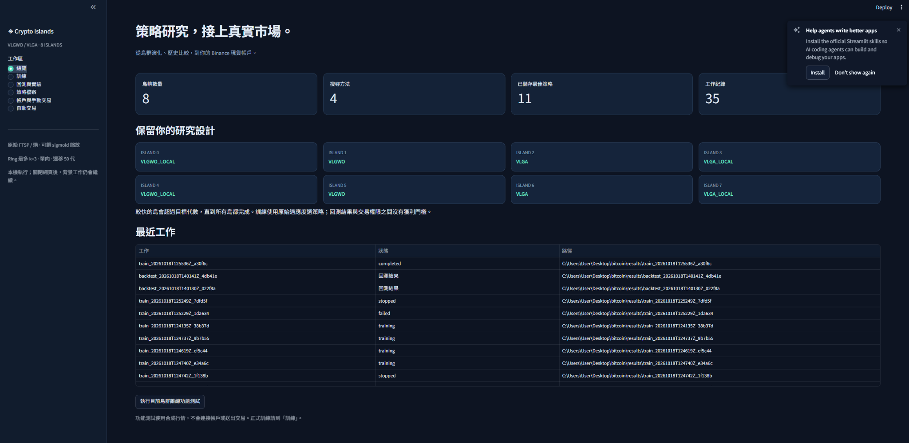
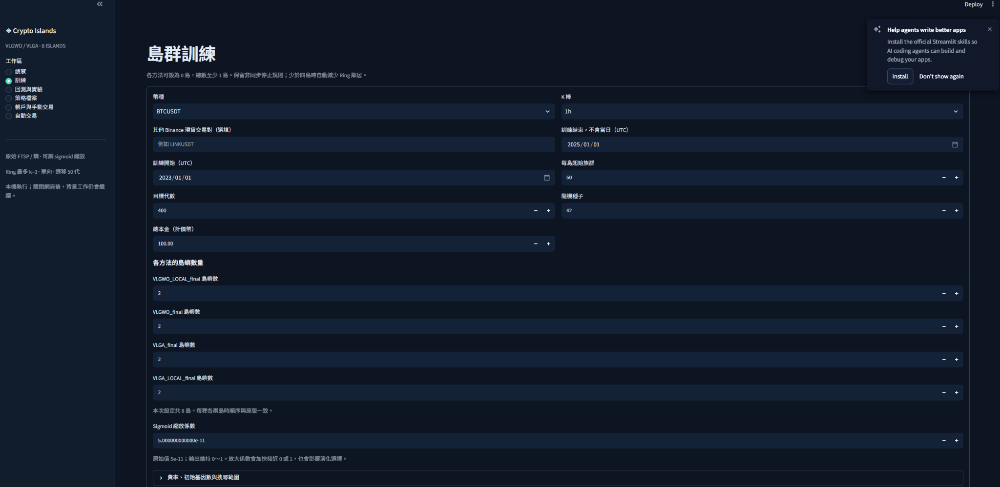
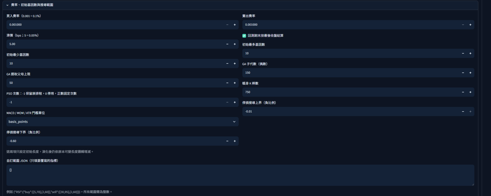
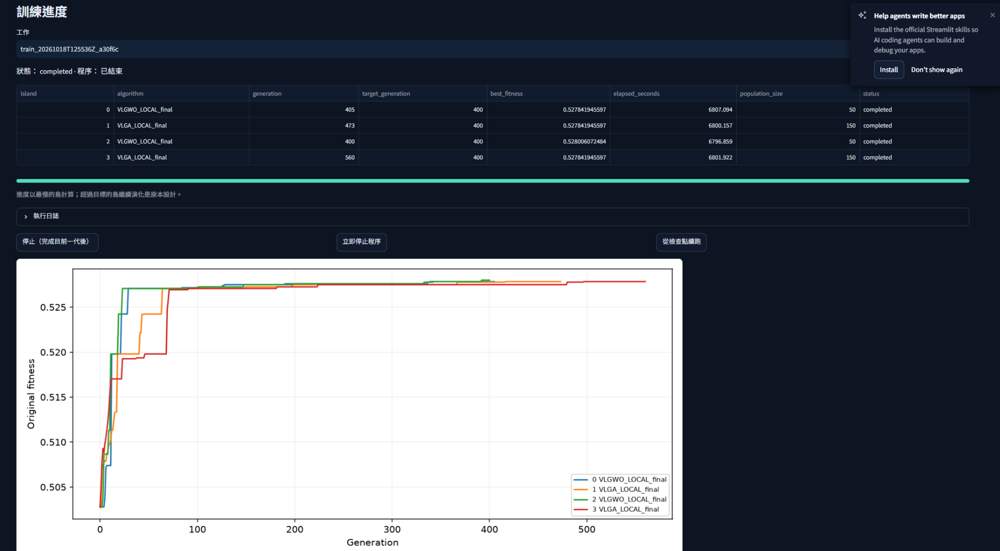
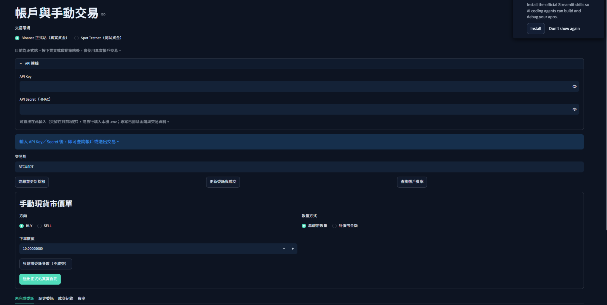
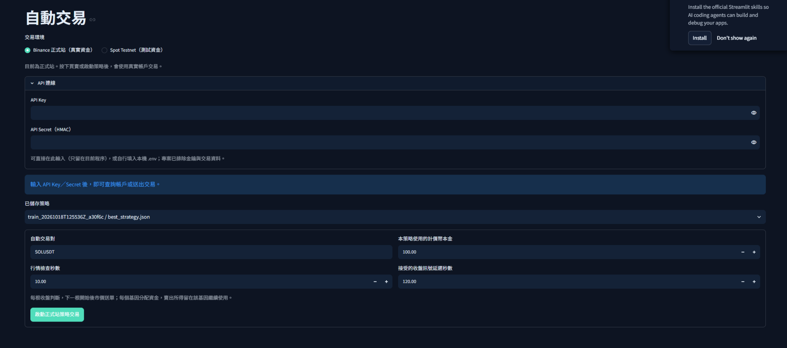

# 虛擬貨幣策略最佳化與回測平台

延伸自我的碩士論文研究，將可變長度灰狼最佳化（VLGWO）、遺傳演算法（VLGA）與平行島嶼模型應用於虛擬貨幣交易策略搜尋，並以 Python 與 Streamlit 建立操作介面。

本專案整合資料取得、策略訓練、策略保存及指定期間回測，讓研究方法能在同一套工具中設定、執行與比較。

## 回測成果亮點

以下為平台中一組已儲存的歷史回測結果，策略與 Buy and Hold 採用相同初始本金。

| 指標 | 演化策略 | Buy and Hold |
|---|---:|---:|
| 初始本金（USDT） | 500.00 | 500.00 |
| 期末資產（USDT） | 570.51 | 376.37 |
| 淨損益（USDT） | +70.51 | −123.63 |
| 總報酬率 | **+14.10%** | **−24.73%** |
| 最大回撤 | **15.29%** | **74.87%** |

**這次回測中，策略報酬領先 Buy and Hold 38.83 個百分點，最大回撤低 59.58 個百分點。**

從資產曲線可觀察到，策略未完全跟上部分上漲行情，但在後續下跌階段的回落幅度較小，期末仍保有正報酬。

這是特定歷史回測案例，不代表其他幣種、期間或未來交易也會有相同表現。圖中為已儲存的結果；完整起訖日期與該次成本設定仍需依原始回測紀錄補充，因此不將它標示為已確認的全年、年化報酬或實盤績效。

## 1. Dashboard 總覽

首頁集中呈現島嶼配置、搜尋方法、已儲存策略與歷次工作狀態，方便管理不同的訓練與回測實驗。

系統包含 VLGWO、VLGA 與兩者加入局部搜尋的版本。預設每種方法各兩島，共八島，也可以依實驗需求調整配置。

## 2. 訓練與搜尋參數

可從介面設定交易對、K 棒週期、訓練期間、初始本金、目標代數、每島族群及四種方法各自的島嶼數量。同一次訓練中的各島共用相同 sigmoid 縮放係數，以保持適應度比較的一致性。

進階設定包含手續費、滑價、初始基因數、GA 父母與子代數、局部搜尋次數，以及停損與指標參數範圍。染色體在演化中仍保留可變長度設計。

以上為操作介面的設定範例，不代表前述回測使用了完全相同的設定。

## 3. 非同步島群演化

訓練頁面顯示各島代數、最佳適應度、族群大小與執行時間，並繪製適應度收斂曲線。

下圖為四島配置的訓練紀錄，由 VLGWO_LOCAL 與 VLGA_LOCAL 各執行兩島。目標為 400 代，各島實際完成 405、473、400 與 560 代。

不同方法的運算速度不同，因此較快的島會繼續演化，直到每個島都達到目標代數，保留原研究的非同步運作方式。

## 4. 策略保存與回測分析

- 將訓練產生的策略保存為 JSON，供後續回測與實驗使用。
- 指定回測期間，與 Buy and Hold 比較績效。
- 查看資產曲線、最大回撤、逐筆交易、委託紀錄及每月報酬。
- 模擬交易納入手續費、滑價與訊號／成交時序。

核心策略的完整指標組合、權重與參數未在此公開。

## 5. 帳戶與手動交易介面

平台建有 Binance 正式站與 Spot Testnet 選項，以及帳戶、費率查詢與手動現貨市價單操作介面。

下圖展示介面設計，API 欄位為空，不作為帳戶連線成功或真實成交的證明。

## 6. 自動交易介面

可選擇已儲存策略，設定交易對、策略本金、行情檢查間隔與可接受的訊號延遲。介面標示依收盤訊號判斷，於下一根 K 棒開始後送出市價委託。

下圖僅展示操作介面；本作品頁的績效數據來自歷史回測，不代表實盤獲利。

## 使用技術

Python、Streamlit、Multiprocessing、Pandas、NumPy、TA-Lib、Git。

## 研究與開發說明

核心最佳化方法延伸自個人碩士論文；平台整合與部分程式開發使用 AI 工具協助。

本儲存庫展示專案架構、操作畫面與實驗成果，完整研究程式碼保留於私人儲存庫。
